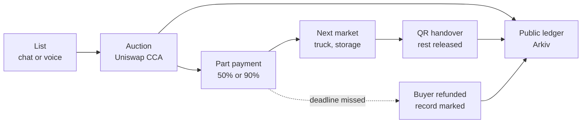
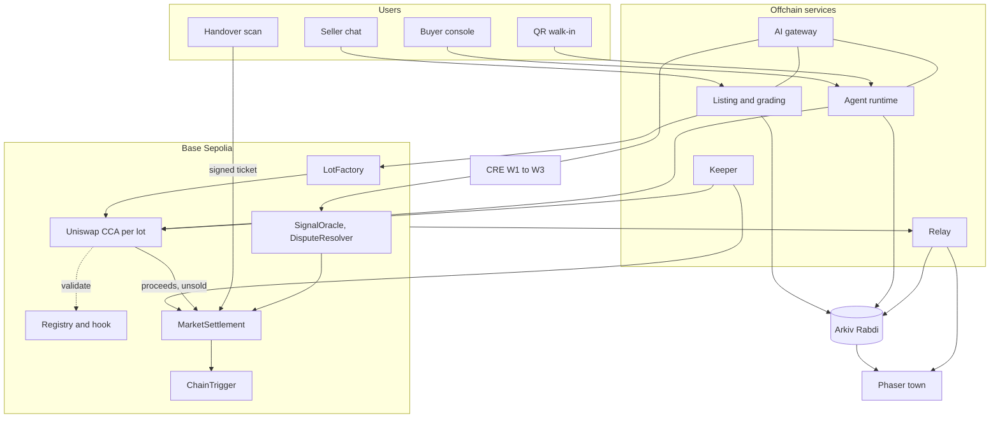
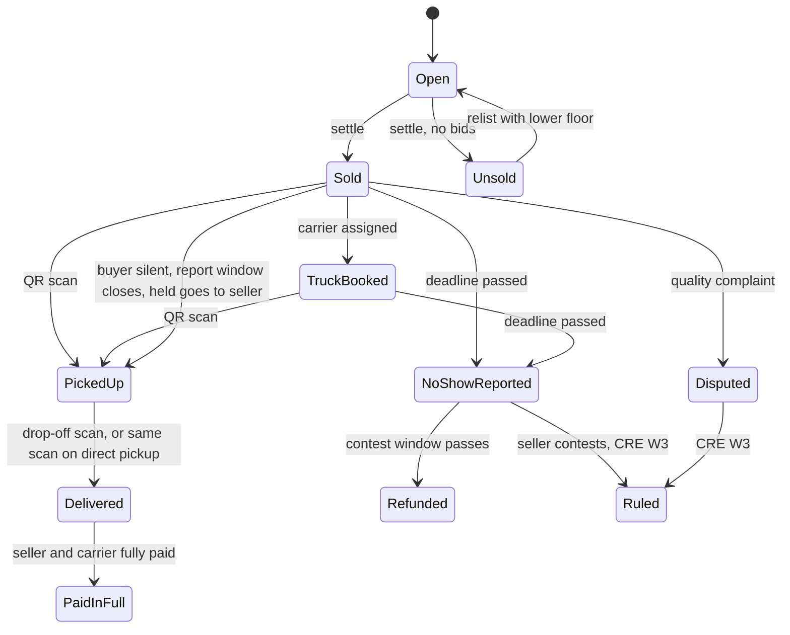

# Fairtown: Source of Truth

> An open market for anything with an expiry date. AI agents and people bid in onchain auctions, sellers are paid in stages, and a living town shows every real bid.

| | |
|---|---|
| Event | ETHGlobal Mumbai, 5 to 7 Nov 2026, Jio World Convention Centre, BKC |
| Submission deadline | **Sat 7 Nov 2026, 09:00 IST** (hard, no late submissions). Internal target Sat 07:00 |
| Track | Classic "From Scratch", **Finalist + Partner prizes** |
| Partner prizes | Select up to 3 at submission. Core: Uniswap, Arkiv, Chainlink. Add-ons: 0G, ENS, World, Hedera |
| Team | 5 people, heavy use of AI coding tools |
| Doc status | Updated 5 Nov 2026, 22:30 IST: renamed to Fairtown, global scenes, global test stablecoins, staged payouts, QR handover, no-show refunds |

## Contents

1. Pitch · 2. Problem with numbers · 3. Core idea · 4. Sectors · 5. The scenes · 6. How each person uses it · 7. Architecture · 8. Onchain design · 9. Arkiv · 10. Chainlink CRE · 11. Agents · 12. AI services · 13. Town · 14. Networks and money · 15. Sponsors · 16. Business model · 17. Novelty · 18. Demo · 19. Team, repo, timeline · 20. Rules · 21. Risks · 22. Open decisions · 23. Glossary · 24. Sources

---

## 1. Pitch

Anything with an expiry date loses value by the hour: a morning catch in Bergen, marigolds before Diwali, a truck driving home empty from Dallas, a GPU rack going dark at 2am. Whoever buys last sets the price, because the seller has no time and no reach.

Fairtown is an open market for all of it. A seller lists by chat or voice. AI buyer agents from anywhere compete in a **Uniswap Continuous Clearing Auction**, which sets one public clearing price per block for every bidder. The seller gets paid in stages: part at the sale, the rest when the buyer scans a QR code at handover. If the deadline passes without handover, the buyer gets the held money back and the seller's public record shows it. The sale also opens the **next market** it needs (a truck, then storage). Every price lands in a **public ledger on Arkiv**, and **Chainlink CRE** brings in FX rates, reference prices, weather and calendar signals, and AI dispute rulings. A **live pixel town** shows it all.

**Trust line:** "We can't force a delivery. We decide in advance who gets paid if it fails."

**Tagline:** "Where everything finds its price, just in time."

---

## 2. The problem, with numbers

| Fact | Number | Source |
|---|---|---|
| Food wasted at retail, food service and homes | 1.05 billion tonnes in 2022, about a fifth of food available to consumers | UNEP Food Waste Index 2024 |
| Food lost between harvest and retail | About 13% | FAO |
| Empty truck miles | 20 to 35% of US truck miles | Uber Freight via MarketScale |
| Norwegian fresh cod | Average NOK 97.67/kg in 2026 winter fishing through week 13, up 31% on 2025 | Råfisklaget via The Fishing Daily |
| Valentine's flowers | Royal FloraHolland traded 464 million flowers in the 2026 run-up, including 150 million roses | AIPH |
| Kenya | Supplies 38% of EU flower imports; about 9,000 tons of roses handled by Swissport for Valentine's 2024, with aircraft capacity limits | Food Business MEA |
| GPUs | Average utilization about 5% across tens of thousands of Kubernetes clusters before optimization. Vendor report, includes night and weekend dips | Cast AI via HPCwire |
| Nigerian tomatoes | About 45% lost after harvest each year; about 50% in a glut | PwC and growers' association via BusinessDay |
| Marigold spread | At Dussehra, vendors paid farmers ₹20/kg while retail was ₹80 to 100/kg | Mumbai Live, Lokmat Times |
| Commission in one Indian market | Vashi APMC: onion 6.5%, vegetables 8%, fruit 10%. 2013-14 data, quote as "up to" | Economic Survey 2014-15 |
| Precedent | Dutch flower clock auctions have priced flowers by auction for over a century | Auctions suit perishables |

**The pattern:** sellers of expiring things have no time and no reach, buyers are few and local, prices are opaque, payment and delivery are a matter of trust.

---

## 3. Core idea



### What changes

| Today | Fairtown |
|---|---|
| Local buyers only | Any registered agent, anywhere |
| Price by haggling or connections | Public clearing price each block, same for every bidder |
| Payment late, or paid and hoping for delivery | Staged by rule, with a deadline at every step |
| Quality argued at the yard | Inspect, scan or dispute; AI ruling on photos |
| Prices invisible | Public record, no API key |
| Truck home empty, storage by phone | Each sale opens transport and storage auctions |

### Why it needs a blockchain

| Part | Onchain? | Why |
|---|---|---|
| Auction and clearing | Yes | A neutral price no operator can bend, with money locked before bidding |
| Staged payout, refunds | Yes | Rules fixed in advance, nobody holds the money at their discretion |
| Chained markets | Yes | Settlement composes into the next market |
| Price ledger | Yes (Arkiv) | Public, permissionless, can't be edited |
| Chat, grading, agents, town | No | Offchain is fine. Users never see crypto |

### What the chain can't do

It can't see onions change hands. Handover evidence is a two-party QR scan plus photos. Fairtown limits the damage from a lie and makes it public, but it doesn't prove physical truth.

---

## 4. Sectors

| # | Building | What's sold | Real places | Scope |
|---|---|---|---|---|
| 1 | **Fish Dock** | Morning catch | Bergen, Tsukiji outer market, Grimsby, Sassoon Dock | **Live, main story** |
| 2 | **Freight Yard** | Empty truck and cargo capacity | Dallas to Houston, Bergen to Oslo, Nairobi to Amsterdam cargo | **Live, chained** |
| 3 | **Compute Yard** | Idle GPU hours | Any data centre | **Live, simulated provider** |
| 4 | **Flower Hall** | Flowers | Dadar, Aalsmeer, Naivasha | **Live** (marigold), seeded (roses) |
| 5 | **Harvest Hall** | Produce | Mile 12 Lagos, Lasalgaon, Hunts Point | Seeded |
| 6 | **Cold Vault** | Storage slot-days | Anywhere | Seeded, chained |
| 7 | **Neighbourhood Pool** | Pooled household orders | Co-ops, housing societies | Seeded |
| 8 | Roadmap | Bakery surplus, tonight's hotel rooms, concert seats, surplus milk | | Vision slide |

**Boundary rule:** only things that lose value with time. That's why one engine serves them all.

---

## 5. The scenes

Names are fictional. Prices are illustrative unless a source is cited.

**Cast:** Ingrid Solheim (Bergen boat), Hanse Kitchen Group (Hamburg restaurants, agent), Fjord Processing (Bergen, agent), Lars (Bergen reefer truck), Maya Torres (Dallas truck owner), Gulf Produce (Houston wholesaler, agent), Northlight Compute (GPU provider), Atlas Labs (AI lab agent), Ganesh Pawar (marigold grower near Pune), Dadar Flower Traders (agent), Wanjiru Kamau (Naivasha rose farm), Bloom & Co (Amsterdam florist agent), Amina Bello (Lagos tomato seller), Mile 12 Cooperative (agent), Shanti Niwas (Mumbai housing society agent).

### Scene 1: The Bergen cod clock (main story)
- 05:00. Ingrid types: "600 kg cod, landed 04:40, Bergen". The grader checks photos against EU freshness categories and returns grade A.
- Open-Meteo shows a real storm forecast, or a forced one labelled forced. CRE posts a signal, and buyers walk to the dock.
- Reference €8.30/kg. Floor €7.50. It clears with an average paid of €9.10/kg, so it raises €5,460.
- **Money:** fee €54.60. Ingrid is new, so she gets €2,702.70 now and €2,702.70 is held.
- `TransportNeeded` opens a Bergen to Oslo truck auction. Lars wins it, and the screen moves to **Truck booked**.
- At the dock, Lars scans Ingrid's QR. The held €2,702.70 goes to Ingrid: **Picked up**.
- In Oslo, Hanse scans Lars's QR. The truck is paid the rest: **Delivered**, then **Paid in full**, because everyone on the lot has now been paid.

### Scene 2: The empty run home
- Maya finishes a Dallas drop at 11:00 and lists 18,000 kg of space to Houston, leaving 14:00. She's proven, but trucks always use a 10% advance.
- Gulf Produce's agent bids. Maya scans nothing at pickup, because she is the seller of capacity. Gulf scans Maya's QR at drop-off to release the rest.
- **Point:** one sentence anyone understands, a truck that would have earned nothing gets paid.

### Scene 3: The GPU going dark
- Northlight lists 200 GPU hours starting 02:00. Atlas Labs' agent has a compute budget and bids against two other agents with no human involved.
- Handover here is automatic: the provider's agent issues an access ticket, and the buyer's agent confirms it after a health check. Miss the start time, and the buyer agent reports a no-show.
- **Honest label:** the provider is simulated in this demo. The auction and money are real on testnet.
- **Point:** an AI agent buying its own compute is the cleanest example of an expiring asset.

### Scene 4: The Diwali marigold rush
- Lakshmi Puja is Sun 8 Nov 2026. CRE W2 sees it in the calendar and posts "Diwali in 3 days" with no forcing.
- Flower Hall lights up. Ganesh lists 2 tonnes. A judge scans a QR on the screen, joins as an avatar and outbids an agent from their phone.
- Settled in `tUSD`, displayed in ₹ through daily FX, marked test money.

### Scene 5: The rose flight to Amsterdam (seeded)
- Wanjiru's roses must make a cargo cutoff before Valentine's Day. Bloom & Co's agent buys. A chained auction sells the cargo slot. Forced signal, labelled forced, because the date isn't now.

### Scene 6: Lagos tomatoes (seeded)
- A glut hits Mile 12. Amina lists 3 tonnes. Mile 12 Cooperative wins and requests cold storage, which opens a Cold Vault slot auction. Shanti Niwas shows pooled buying on the same engine.

### Scene 7: The no-show (shown on purpose)
- A seeded seller, "Coastal Catch", takes the advance and never hands over. The deadline passes. The buyer reports. The contest window closes with no answer. The held share returns to the buyer, the record shows the no-show, and buyer agents stop bidding on that seller.

### What the ledger enables
- Price weather map per market against its own 30-day average.
- Insurer or lender reads public prices and a seller's verifiable record.
- Seller advice with its basis numbers shown.

---

## 6. How each person uses it

### Seller
1. Sends a message (text first, English voice later) and takes 1 to 3 in-app photos with a lot code in frame.
2. The listing agent fills a lot and grades it. The seller sees the suggested floor and what they'll get: "€2,702 at sale, the rest at handover".
3. Confirms. Sees the auction, then "€X received".
4. At handover, opens **Show handover code** and shows the QR.
5. Never sees a wallet, token or gas.

### Buyer (business)
1. Sets a mandate: commodity, max price, minimum grade, delivery place, budget, currency.
2. Watches the agent bid in town and in the console.
3. At pickup: inspects, then scans the QR, or disputes with photos.

### Truck owner
Gets capacity jobs automatically, scans the seller's QR at pickup, shows their own QR at drop-off.

### Society
Families add items, the society agent pools and bids as one.

### Judge or visitor
Scans a QR, appears as an avatar, bids from a phone on a live lot.

---

## 7. Architecture



| Component | Lives in | Job |
|---|---|---|
| Seller chat | `apps/web` | Listing, photos, payout, show QR |
| Buyer console | `apps/web` | Mandates, bids, scan QR, disputes |
| Town | `apps/web` | Live view of every market |
| Listing agent | `services/agents` | Message to lot, grading, floor |
| Agent runtime | `services/agents` | Buyer, seller, truck, compute, society agents |
| Keeper | `services/keeper` | Checkpoint, settle, exits, claims, deadlines |
| AI gateway | `services/agents` | Any LLM, vision or speech provider |
| Relay | `services/relay` | Chain, Arkiv and intents into one stream |
| Contracts | `contracts` | Lots, auctions, staged payout, chaining, registry, oracles |
| CRE workflows | `cre` | FX and reference, signals, disputes |
| Add-ons | `services/addons` | 0G settings live in the gateway; ENS, World, Hedera here, all switchable |

---

## 8. Onchain design

### 8.1 Facts about CCA (verified against repo source, v2.1.0, on 5 Nov)

- Repo `Uniswap/continuous-clearing-auction`, MIT, Solidity 0.8.26, Foundry. Use tag **v2.1.0**.
- Website guides and the uniswap-ai skill still show the v1 API. v2 uses `create()`, `getAddress()`, `IDistributor`, `_protocolFeeController`. **Code against the source.**
- Works standalone, no v4 migration. Currency is any normal ERC-20, 6+ decimals, not fee-on-transfer. Each auction can use a different currency.
- Bids pull currency through Permit2 (`0x000000000022D473030F116dDEE9F6B43aC78BA3`): `token.approve(PERMIT2, max)` once, `Permit2.approve(token, auction, amount, expiry)` per auction.
- Prices are Q96: `currencyWei / tokenWei * 2^96`. Floor must be a multiple of `tickSpacing`, at least `2^32 + 1`. Tick spacing at least 2.
- Block-based. Price never decreases within an auction. One checkpoint per block at most.
- **There is one clearing price per block, not per auction.** `CheckpointAccountingLib.calculateFill` computes a bid's tokens from `cumulativeMpsPerPrice` over the blocks it was live, so its effective price is an average over those blocks. Different bidders can pay different averages.
- `sweepCurrency()`: only `fundsRecipient`, after `endBlock`. `sweepUnsoldTokens()`: only `tokensRecipient`. Both checkpoint the end block themselves if needed. With `requiredCurrencyRaised = 0` every auction graduates, including zero-bid auctions.
- `exitBid` requires `maxPrice` strictly above the final clearing price. `exitPartiallyFilledBid` takes checkpoint hints. No owner checks, funds go to the bid owner.
- Gas (repo snapshots): `submitBid` about 154k to 361k, `checkpoint` about 170k, `exitBid` about 84k, `claimTokens` about 67k.
- Canonical factory v2.1.0 `0x000000001F26a0044BaA66024e7b6599c61963F8` on Ethereum, Base, Arbitrum, Unichain, Robinhood Chain and Sepolia. **Not listed on Base Sepolia**, so we deploy our own with zero fee controller.

### 8.2 Interfaces we use

```solidity
struct AuctionParameters {
    address currency; address tokensRecipient; address fundsRecipient;
    uint64 startBlock; uint64 endBlock; uint64 claimBlock;
    uint256 tickSpacing; address validationHook; uint256 floorPrice;
    uint128 requiredCurrencyRaised; bytes auctionStepsData;
}
function create(address token, uint256 amount, bytes calldata configData, bytes32 salt) external returns (IDistributor);
function onTokensReceived() external;
function submitBid(uint256 maxPriceQ96, uint128 amount, address owner, bytes calldata hookData) external payable returns (uint256 bidId);
function checkpoint() external returns (Checkpoint memory);
function exitBid(uint256 bidId) external;
function exitPartiallyFilledBid(uint256 bidId, uint64 lastFullyFilledCheckpointBlock, uint64 outbidBlock) external;
function claimTokens(uint256 bidId) external;
function sweepCurrency() external;
function sweepUnsoldTokens() external;
function currencyRaised() external view returns (uint256);
function totalCleared() external view returns (uint256);
function clearingPrice() external view returns (uint256);
interface IValidationHook {
    function validate(uint256 maxPrice, uint128 amount, address owner, address sender, bytes calldata hookData) external;
}
```

**Schedule:** end-weighted, built with the encoding in `test/utils/AuctionStepsBuilder.sol`, `abi.encodePacked(uint24 mps, uint40 blockDelta)`. Default about 50% of supply in the last block:

| Duration | Early mps per block | Last block mps | Sum |
|---|---|---|---|
| 30 | 172,413 | 5,000,023 | 10,000,000 |
| 45 | 113,636 | 5,000,016 | 10,000,000 |
| 60 | 84,745 | 5,000,045 | 10,000,000 |
| 90 | 56,179 | 5,000,069 | 10,000,000 |

**Why:** it narrows the gap between early and late bidders. **Trade-off:** more weight at the end invites last-block bidding, which CCA's even issuance is meant to reduce. S1 measures the spread and tunes it (target: two bidders' averages within 5%). Ask a mentor.

### 8.3 Our contracts

| Contract | Responsibility |
|---|---|
| `MockStable` | `tUSD` and `tEUR`, 6 decimals, operator mint, capped public drip. Testnet only |
| `LotToken` | 18 decimals, 1 token = 1 unit (kg, kg-route, slot-day, gpu-hour). Delivery claim. One per lot and per relist |
| `LotFactory` | One call creates token and funded CCA, with a currency from an allowlist |
| `AgentRegistry` + `AgentRegistryHook` | Registered bidders only |
| `MarketSettlement` | Recipient of every auction. Fee, tier advance, held amount, handover, no-show, quality rulings, relists, seller record |
| `ChainTrigger` | `TransportNeeded`, `StorageNeeded` |
| `DisputeResolver` | CRE receiver for quality and no-show rulings |
| `SignalOracle` | CRE receiver for reference prices, FX and demand signals |

### 8.4 Payout rules

```
fee      = raised * FEE_BPS / 10000                    (1%)
net      = raised - fee
advance  = net * advanceBps / 10000
held     = net - advance

advanceBps: truck lots  = 1000  (10%, always)
            proven      = 9000  (90%)
            new         = 5000  (50%)
proven = cleanLots[seller] >= 3 && openNoShows[seller] == 0, or marked by operator (seeded, disclosed)
```

`avgPerUnit = raised * 1e18 / soldTokens`. Store it, because this is what buyers paid on average. `finalClearingPerUnit` is also stored for the chart.

| Raised | Fee | New: now / held | Proven: now / held |
|---|---|---|---|
| 1,000.00 | 10.00 | 495.00 / 495.00 | 891.00 / 99.00 |

### 8.5 Handover ticket (the QR)

EIP-712 typed data signed by the seller's wallet through OpenZeppelin `EIP712` and `SignatureChecker`:
```
Handover(uint256 lotId, address buyer, uint256 tokenAmount, uint64 expiryBlock)
```
- Seller opens **Show handover code**. The service signs and renders the payload as a QR: `{lotId, buyer, tokenAmount, expiryBlock, sig}`.
- Buyer or the assigned carrier scans. Their own wallet sends `confirmHandover(...)`. So one tx carries both parties' agreement.
- Contract checks the signature, sender, expiry and an unused ticket, burns the buyer's lot tokens and pays the held share.
- Buyer tokens must be claimed first (the keeper does this right after settle).

### 8.6 Lifecycle



### 8.7 Design notes and limits

- **Prices that drop with the clock:** a floor is fixed within an auction, so decay happens through relists. Each relist burns unsold tokens and mints a new `LotToken`, so per-lot buyer accounting stays clean.
- **Reverse auctions:** a truck sells capacity tokens and shippers bid.
- **Transport fails:** if no truck lot clears before `readyByBlock`, the buyer is notified and arranges pickup; the deadline still applies.
- **Multiple buyers on one lot:** each has a share and a ticket. The demo chains one truck per lot for the largest buyer.
- **Deadlines:** demo values in blocks (section 14). Real values are hours and differ per sector.
- **Gas:** paid by the operator and keeper on testnet.

---

## 9. Data layer (Arkiv)

### 9.1 Why Arkiv, not a normal database

1. **Prices and seller records are public goods.** Anyone queries them without asking us. A buyer agent from another company can read a seller's no-show record directly.
2. **Expiry is the product.** A cod lot's entity dies soon after the cod does. Bids die with the auction, while price and reputation records live on.
3. **Ownership means something.** Sellers own lots, buyers own bids, the settlement writer owns read-only prices.

**What we keep off Arkiv:** photos (too large, and private; only hashes), money (chain), chat, session tokens. Be honest in `why-arkiv.md`: live walking in town needs our relay, so if our server dies the board and ledger keep working but the live animation doesn't.

### 9.2 Entities

Namespace `fairtown.v1.`

| Entity | Owner | Key filters | Lifetime | Written by |
|---|---|---|---|---|
| `lot` | seller agent | sector, commodity, grade, market, place, currency, status, lotId, auction, floorPerUnit, endBlock, parentLotId | auction end + 1 day | Listing agent |
| `bid` | buyer agent | lotId, agent, maxPerUnit, amount, block | auction end + 1 hour | Agent runtime |
| `price` | settlement writer | sector, commodity, grade, market, place, currency, lotId, finalClearingPerUnit, avgPerUnit, soldUnits, day | 180 days, read-only, permissionless extension | Writer |
| `reputation` | settlement writer | seller, tier, cleanLots, noShows, refundedBps | 180 days, permissionless extension, new entity per change | Writer |
| `capacity` | truck or storage agent | kind, fromMarket, toPlace, qty, readyByBlock, lotId | ready-by + 1 day | Agents |
| `signal` | writer | kind, place, severity, expiresAtBlock | until expiry | Writer |
| `agent` | agent wallet | role, name, building | 30 days | Agent runtime |

### 9.3 Queries the product depends on

- Town: open `lot`s by market.
- Price weather: `price` for a commodity and market, last 30 days.
- Seller advice: last 10 `price` records for the same commodity and grade.
- Buyer agents: latest `reputation` for a seller before bidding.
- Trucks: `capacity` and open `lot`s on a route.
- README query judges can run.

### 9.4 SDK (checked 5 Nov 2026)

**Decision D-10 closed:** Arkiv's prize page names **Rabdi**, chain ID 7794095, RPC `https://rpc.rabdi.db-chain.testnet.arkiv.network`, indexer `https://indexer.rabdi.db-chain.testnet.arkiv.network`, explorer `https://rabdi.explorer.arkiv.network`. SDK `@arkiv-network/sdk` is **1.0.1** on npm; pin `1.0.x`. Needs Node 22.10+ or Bun. Access keys at hub.arkiv.network/access-keys; tGLM at hub.arkiv.network/faucet.

```ts
import { createPublicClient, createWalletClient, ExpirationTime } from "@arkiv-network/sdk"
import { rabdi } from "@arkiv-network/sdk/chains"
import { addr, bytes, str, u64, u256, defineSchema } from "@arkiv-network/sdk/schema"
import { and, eq, gt } from "@arkiv-network/sdk/query"
import { http, type Hex } from "viem"
import { privateKeyToAccount } from "viem/accounts"

const chain = rabdi({ accessKey: process.env.ARKIV_ACCESS_KEY ?? "" })
export const arkivRead = createPublicClient({ chain, transport: http() })
export const arkivWrite = createWalletClient({ chain, transport: http(), account: privateKeyToAccount(process.env.ARKIV_PRIVATE_KEY as Hex) })

export const Price = defineSchema("fairtown.v1.price", {
  sector: str().indexed(), commodity: str().indexed(), grade: str().indexed(),
  market: str().indexed(), place: str().indexed(), currency: str().indexed(),
  finalClearingPerUnit: u256().indexed(), avgPerUnit: u256().indexed(),
  soldUnits: u256().indexed(), day: u64().indexed(), lotId: u256().indexed(), tx: str(),
})

await arkivWrite.createEntity(Price, values, {
  expiration: ExpirationTime.fromDays(180),
  flags: { readonly: true, permissionlessExtension: true },
})

const { entities } = await arkivRead.select({ $key: true, avgPerUnit: true, market: true })
  .from(Price).where(and(eq("commodity", "cod"), eq("place", "bergen"))).fetch()
```

`dec` and `addr` values must be wrapped when written; plain strings can be used as they are. `query.toString()` prints the raw query for the README. Max 100 rows per page. `watchEntityEvents` polls every half block, carries no attributes, and **fires nothing on expiry**, so the town checks `$expiresAt`. Limits: 32 attributes (31 with a named schema), 32-byte names, 128-byte strings, 128 KiB per bytes value and create. Don't blindly retry a write that timed out.

---

## 10. Chainlink CRE

| Workflow | Trigger | Steps | Onchain |
|---|---|---|---|
| **W1 FX and reference** | Cron | Live FX from Frankfurter (no key, daily). Reference prices through a `PriceSource` adapter. Default: dated, cited snapshot served by the agents service. Optional adapters: Agmarknet, USDA MyMarketNews, only if their APIs work with a key on day one | `SignalOracle` kinds 1 and 3 |
| **W2 Demand signals** | Cron | Open-Meteo for Bergen, Dallas, Mumbai, Nairobi, Lagos. Calendar by market: Diwali 8 Nov 2026, Thanksgiving 26 Nov 2026, Christmas, Valentine's Day, Ramadan, Lunar New Year | `SignalOracle` kind 2 |
| **W3 Rulings** | EVM log trigger on `DisputeOpened` | Fetch evidence, vision LLM with the sector rubric, median refund, for quality complaints and contested no-shows | `DisputeResolver` |

**Prize fit:** integrates a chain with external APIs and an LLM, shown by CLI simulation, meaningfully used.

**SDK (checked):** `@chainlink/cre-sdk` 1.23.0 is current. TypeScript compiles to WASM: use `.result()`, not `await`. CLI: `cre init`, `cre login`, `cre workflow simulate`, `cre workflow supported-chains`.

Base Sepolia: chain name `ethereum-testnet-sepolia-base-1`, selector `10344971235874465080`, simulation mock forwarder `0x82300bd7c3958625581cc2f77bc6464dcecdf3e5`. Confirm with `cre workflow supported-chains`, because availability depends on your account.

```bash
cre workflow simulate ./cre/w1-fx-reference --target local-simulation
cre workflow simulate ./cre/w1-fx-reference --broadcast --target local-simulation
cre workflow simulate ./cre/w3-rulings --non-interactive --trigger-index 0 --evm-tx-hash 0x... --evm-event-index 0 --broadcast --target local-simulation
```
`--limits` enforces production quotas during simulation; `--listen` re-runs on each incoming trigger.

**Receivers** implement `IReceiver.onReport(bytes metadata, bytes report)` with ERC-165, accept only the forwarder, and drop stale reports. No `Date.now()` or randomness in node mode. A malformed model answer means no report, never a default refund.

**Frankfurter:** `https://api.frankfurter.dev/v2/rates`, no key, daily, display and reference conversion only. Check the exact query format and that INR, NOK, KES and NGN are covered before relying on them.

---

## 11. Agents

| Agent | Demo count | Decides | Inputs |
|---|---|---|---|
| Seller | 6 | Floor, duration, relist | Reference, recent clears, time left |
| Buyer | 12 | Bid or pass, max price, amount | Mandate, budget, signals, clearing, seller reputation |
| Society | 2 | Pooled bid | Family lists, budget |
| Truck | 4 | When and where to list | `TransportNeeded`, location |
| Cold store | 2 | Slot floor | `StorageNeeded`, occupancy |
| Compute provider | 1 | GPU-hour floor | Idle forecast (simulated) |
| Grader | service | Grade, defects, confidence | Photos, rubric |
| Arbiter | in W3 | Refund share | Evidence, rubric |

**Runtime:** one Node process, event-driven plus a 3s tick, no heavy framework. Each agent is a plain object with a viem wallet. LLM returns `{action, maxPerUnit?, amount?, moveTo?, reason}`. Guardrails are code: budget, mandate max, min increment, rate limit, per-auction cap, and **skip sellers with a recent no-show unless the mandate allows it**. Rule strategy is the fallback. One tx queue per wallet. `reason` appears as a speech bubble.

```ts
const Decision = z.object({
  action: z.enum(["bid", "pass", "list", "relist", "move", "handover", "report_no_show"]),
  maxPerUnit: z.string().regex(/^\d+$/).optional(),
  amount: z.string().regex(/^\d+$/).optional(),
  moveTo: z.enum(BUILDINGS).optional(),
  reason: z.string().max(80),
})
```

---

## 12. AI services

**Rule:** every AI call goes through `services/agents/src/ai`, with the provider chosen by env.

| Role | Dev | Demo | Notes |
|---|---|---|---|
| `BIDDER_MODEL` | Local via Ollama | Local or cloud | Many small calls; rules fall back |
| `LISTING_MODEL` | Local or cloud | Cloud | Structured output |
| `VISION_MODEL` | Local vision | **0G Router with verification**, if `tee_verified` works | Grader and arbiter |
| `STT_PROVIDER` | Browser speech | Browser speech or Whisper via `/audio/transcriptions` | English first |

```bash
LLM_BASE_URL=http://localhost:11434/v1
VISION_BASE_URL=https://router-api.0g.ai/v1     # testnet: https://router-api-testnet.integratenetwork.work/v1
VISION_MODEL=<from pc.0g.ai/models>
VISION_EXTRA_BODY={"verify_tee":true}
```

Vercel AI SDK 7 (`ai`, 7.0.163 at last check) with `@ai-sdk/openai-compatible`. `stepCountIs` is now `isStepCount`.

### 12.1 0G specifics (checked 5 Nov)

- OpenAI-compatible Router. Key from pc.0g.ai, Dashboard, API Keys (`sk-...`). Mainnet and testnet have separate endpoints, keys and balances. Ask at the booth for team credits.
- `verify_tee: true` in the body checks the provider's TEE signature. The result is `x_0g_trace.tee_verified`: `true`, `false` (treat as untrusted) or absent.
- Every response has `x_0g_trace.request_id` and `x_0g_trace.provider`. The `ZG-Res-Key` header gives the chat ID. Independent check: `broker.inference.processResponse(provider, chatID)` from `@0gfoundation/0g-compute-ts-sdk` (0.9.0).
- Trust header: `X-0G-Provider-Trust-Mode: private` routes only to TeeML providers.
- JSON mode through `response_format` where the model supports it.
- **Unverified:** which vision models have verifiable providers. Candidates by price: Qwen2.5-VL-72B-Instruct ($0.045 in, $0.195 out per 1M). Test first. If `tee_verified` is absent, the UI says "model logged, not attested" and the claim is dropped.
- The AI SDK hides custom fields, so wrap `fetch` in the provider to capture the trace.

### 12.2 Grading rubrics (global standards)

| Sector | Rubric | Output |
|---|---|---|
| Fish | EU freshness categories E, A, B, Unfit (Regulation 2406/96; FAO guide). E: convex eyes, black pupil, bright red gills. A: flat eyes, slightly opaque pupil, pink gills. B: slightly concave eyes, grey pupil, brown or grey gills | `fresh_e`, `fresh_a`, `fresh_b`, `unfit` |
| Produce | Class rubric: extra, class 1, class 2, based on damage, ripeness, size. AGMARK where an Indian lot needs a government standard (onion: Extra, I, II; size A 10 to 20 mm, B 21 to 40, C 41 to 70, D 71+) | `extra`, `class_1`, `class_2` |
| Flowers | Bloom stage, stem, wilt, colour | `bloom_a`, `bloom_b` |
| Compute | Health check, not a photo: GPU model, memory, latency, simulated in demo | `gpu_verified` |

Output `{grade, defects[], confidence}`. It's an AI opinion, shown as one.

---

## 13. The town

| Piece | Choice |
|---|---|
| Engine | Phaser 4.2.x (4.2.1 at last check), React + Vite + TS template |
| Maps | Tiled JSON |
| Pathfinding | `easystarjs` |
| Live data | Relay plus Arkiv reads |
| QR | `qrcode` (1.5.4) to draw, `@yudiel/react-qr-scanner` (2.6.0) to scan |

| Event | Town reaction |
|---|---|
| `lot.listed` | Stall with icon, floor and **expiry countdown** |
| `agent.intent` | Sprite walks, bubble shows reason |
| `bid.placed` | Coin animation |
| `price.tick` | Price label ticks up |
| `lot.settled` | Stall flashes, toast "€X received, €Y held" |
| `transport.needed`, `carrier.assigned` | Truck leaves the yard, status **Truck booked** |
| `handover.confirmed` | Crate moves, **Picked up**, toast shows the rest received |
| `lot.delivered` | Truck arrives, **Delivered** |
| `lot.paid_in_full` | Stall glows gold, **Paid in full** |
| `noshow.reported` | Red timer over stall |
| `noshow.refunded` | Coins return to the buyer, seller's sign gets a public mark |
| `signal` | Storm clouds, festival lights, quiet dock |
| Price weather toggle | Buildings tinted by price against 30-day average |
| QR walk-in | New avatar at the gate |

**HUD:** world clock (Bergen, Dallas, Mumbai, data centre), each lot's five-step timeline, LIVE or REPLAY badge, TEST MONEY badge.

```
+----------------------------------------------------------------+
|  [Fish Dock]~~~~~~~sea~~~~~~          [Freight Yard]==road==   |
|                                                                |
|     [Flower Hall]    (town square)  [Compute Yard] [Cold Vault]|
|                                                                |
|  [Harvest Hall]                           [Neighbourhood Pool] |
|                      [Town gate / QR spawn]                    |
+----------------------------------------------------------------+
```

**Skin:** a neutral world town with one sign per scene (Bergen, Dallas, Mumbai, Nairobi, Lagos), not one country's look.

**Art:** Kenney Tiny Town and RPG Urban Pack, Ninja Adventure (CC0). Pixel Market Stalls only after re-reading its licence. Avoid Cute Fantasy free tier and Rustic Market Props. Art is made after kickoff. a16z AI Town and WorkAdventure: ideas only.

---

## 14. Networks and money

| Environment | Chain | Notes |
|---|---|---|
| Local | `anvil --fork-url <base-sepolia> --block-time 1` | Plain anvil has no Permit2 |
| Demo | Base Sepolia, 2s blocks | Own CCA factory |
| Data | Arkiv Rabdi 7794095 | |
| Workflows | CRE simulation on Base Sepolia | |
| Add-ons | ENS on Sepolia, Hedera testnet, 0G Router | Switchable |

**Settlement assets**

| Asset | Address | Use |
|---|---|---|
| `tUSD`, `tEUR` | Our deployment | All agents. Mintable, valueless |
| Circle test USDC | `0x036CbD53842c5426634e7929541eC2318f3dCF7e` | One proof lot. Faucet: 20 USDC per 2 hours per address |
| Circle test EURC | `0x808456652fdb597867f38412077A9182bf77359F` | Optional proof lot |

**Display:** seller and buyer see the settlement currency and a local line, for example "€2,702.70 (about NOK 31,800)". FX never affects a payout. Everything shows TEST MONEY in the demo.

**Demo deadlines (blocks at about 2s):**

| Sector | Auction | Pickup window | Real-world idea |
|---|---|---|---|
| Fish | 45 | 300 (10 min) | A few hours |
| Flowers | 60 | 300 | Same day |
| Produce | 90 | 450 (15 min) | 1 day |
| Truck | 30 | 300 | Departure time |
| Storage | 30 | 150 (5 min) | Start date |
| Compute | 30 | 60 (2 min) | Minutes before the hour |

Contest window 60 blocks (2 min). Report window 300 blocks (10 min). All are env and config values, not constants.

---

## 15. Sponsors

Partner selection happens at submission. Requirements below were read from the live prize page on 5 Nov; recheck before submitting.

### 15.1 Uniswap Foundation: Build with Uniswap, $10,000 ($4k, $3k, $2k, $1k)
- [ ] Public repo, `FEEDBACK.md`, form at https://developers.uniswap.org/hackathon-feedback with its link
- [ ] README points to exact contracts and lines
- **Gets:** CCA as a general market engine for real-world goods, with chained auctions.

### 15.2 Arkiv: Build on Arkiv (from scratch), $4,000 ($3k, $1k)
Judged 25% each: feedback, reach, why Arkiv, how you use Arkiv. The track's own examples include agent bids and listings that expire.
- [ ] Writes to Rabdi with the SDK, a user-visible feature reads it
- [ ] README: writer wallets and one runnable query
- [ ] `/arkiv/schema.md`, `/arkiv/friction.md`, `/arkiv/reach.md`, `/arkiv/why-arkiv.md`, `/arkiv/how-you-use-arkiv.md`
- [ ] Open licence, AI use stated
- Optional **Swarm bonus $500**, doesn't use a partner slot: `/arkiv/swarm.md`. Never put an encrypted Swarm reference on Arkiv as-is, because it contains its key.

### 15.3 Chainlink: Best workflow with CRE, $1,500
- [ ] Workflow integrates a chain with an external API, LLM or data source
- [ ] Successful CLI simulation or deployment
- [ ] Meaningfully used

### 15.4 0G: Build with 0G Private Computer, $5,000 ($2.5k, $1.5k, $1k)
- [ ] Inference in the main flow with request IDs
- [ ] Working app judges can try, reason to return tomorrow
- [ ] One sentence: "Without 0G, buyers can't verify which model graded the lot or ruled the refund."
- [ ] Public repo, video **under 3 minutes**, live link, addresses, team contacts on Telegram and X
- Paid at 0G's discretion. Not wanted: apps where the AI could be removed unnoticed, so grading and rulings must depend on it.

### 15.5 ENS: Best Use of ENSv2, $7,000 ($3k, $2k, $1k, $1k)
- [ ] ENSv2 on mainnet or Sepolia, central to the product, functional, not hard-coded, live demo, open source
- Agents as namespaces earn a bonus. Sepolia addresses: RootRegistry `0xb458d6a3a77919449d03e7a6903c26827c1ec43f`, ETHRegistry `0xd4ebcbbdf463c9c45784603db0ddd499bc44a8b4`, VerifiableFactory `0xda70306c98e97ece36f997a21368e53298572991`, UserRegistryImpl `0x9bd8a88719068d09ecee662f36c0e3856708366a`, PermissionedResolverImpl `0x115eb53f0c60696633855f90b138178fb40b2b2c`.

### 15.6 World: World ID Agent Pass, $5,000 ($2.5k, $1.5k, $1k)
- [ ] Full journey plus a denied, expired or cancelled path where the action doesn't happen
- [ ] Backend validation, debrief on friction
- Use: agent wants to exceed its mandate, which requires fresh human authentication before the bid. Proofs use fake identities on the hackathon setup.

### 15.7 Hedera: AI Agents That Pay, $6,500 ($3k, $2k, $1.5k)
- [ ] x402 endpoint settling on Hedera testnet, agent completes a paid request with no human
- [ ] README with a Hedera transaction ID, video 5 min or less linking HashScan
- Use: `GET /api/intel/:commodity` costs a small fee in test USD (asset `0.0.6001`, 6 decimals). Facilitator options include `https://x402.org/facilitator`. No Solidity is required for this track.

### 15.8 Prize math
Likely ceiling with three firsts: Uniswap $4,000 + Arkiv $3,000 + 0G $2,500 or Hedera $3,000 or ENS $3,000. Finalist (top 10): 1,000 USDC per person for 3 to 5 person teams plus 500 USDC travel per person, plus the finalist pack. Finalist remains the main target.

---

## 16. Business model

| Stream | How | Example |
|---|---|---|
| Fee per cleared lot | 1% from raised | €5,460 lot earns €54.60 |
| Chained-market fees | Same on transport and storage | One sale yields 2 to 3 fee events |
| Premium data | Raw ledger free; cleaned feeds, alerts for insurers, lenders, traders | Subscription |
| Hosted agents | Tuned procurement agents | SaaS |
| Credit referrals (later) | Verifiable seller history | Per loan |

**Costs we must carry:** off-ramp partners, KYC, gas, disputes, legal per country.

**Regulation:** stablecoin rules vary by country. RBI documents from mid 2026 lean toward restricting private stablecoins in India, so an India launch would need rupee rails through regulated partners while the auction and ledger stay onchain. EU sellers would use EURC under MiCA-regulated issuers; check locally. Nothing here is legal advice, and the team should get counsel before any live launch.

---

## 17. Novelty

| Existing thing | What it does | How we differ |
|---|---|---|
| Too Good To Go | Fixed-discount bags, consumers | Real auctions, any seller and buyer, agents |
| Dutch flower clock | Descending auctions in one cooperative | Open to any agent, staged escrow, public prices |
| Norwegian fish auctions | Sales-organization auctions | Open, chained to transport, public failure record |
| GPU marketplaces | Rent compute | Expiring hours by auction, agent as buyer, same engine as fish |
| Freight load boards | Listings and calls | Auction opened by the sale itself, paid on drop-off scan |
| a16z AI Town, AgentCity, town.eth, Agent Town | Simulated agents | Real auctions with testnet money |
| Agri-blockchain projects | Supply-chain tracking | Price discovery and settlement |
| CCA so far | Token launches | First use we found for real goods and chained markets |

**Prepared Q&A:** "Isn't this Too Good To Go?", "Isn't this AI Town?", "Why not a normal database?", "Who verifies quality?", "What if the seller just runs?", "Can the buyer scam the seller?", "What currency do people get?", "Is this legal?", "Does everyone pay the same price?" (No, same clearing price per block; averages can differ, and we publish both.)

---

## 18. The 4-minute demo

| Time | What happens | Proves |
|---|---|---|
| 0:00 to 0:25 | World clock: Bergen, Dallas, Mumbai, data centre, all counting down. One line per clock | Problem, global |
| 0:25 to 1:10 | Ingrid's message arrives. Lot at Fish Dock with grade and verified badge. Agents walk over with reasons | Listing, AI |
| 1:10 to 1:50 | Price ticks, sale. Phone: "€2,702.70 received, the rest at handover". Truck auction, **Truck booked** | CCA, staged pay, chain |
| 1:50 to 2:20 | Live QR scan on stage: **Picked up**, the rest reaches Ingrid. Second scan at drop-off: **Delivered, Paid in full** | Handover |
| 2:20 to 2:50 | Diwali signal fires. Judge scans a walk-in QR, outbids an agent. Cut to Atlas Labs' agent buying GPU hours | CRE, humans and agents |
| 2:50 to 3:30 | Coastal Catch misses a deadline. Buyer refunded on screen, no-show on the public record. Run the Arkiv query live | Trust, Arkiv |
| 3:30 to 4:00 | Vision: rooms, seats, bakery surplus. "We can't force a delivery. We decide in advance who gets paid if it fails. Fairtown." | Close |

**Fallbacks:** pre-recorded segment for each part; local fork; rule-based agents if LLM is slow; manual ticket link if the camera fails.

**Video:** 2 to 4 minutes, 720p or better, computer recording, real voice, no AI voiceover, no speed-up, no music with text. **Aim for about 2:45**, since 0G asks for under 3 minutes and this also fits ETHGlobal's 2 minute minimum.

---

## 19. Team, repo and timeline

| # | Owner | Scope |
|---|---|---|
| 1 | Contracts | Tokens, factory, registry, settlement, trigger, resolver, oracle, tests, deploy |
| 2 | CRE + keeper (integration captain) | W1 to W3, bridge, keeper, combine lead |
| 3 | Agents | Runtime, listing, gateway, Arkiv, relay |
| 4 | Town | Map, sprites, visuals, panels |
| 5 | Apps + pitch | Sell, buy, walk-in, QR, board, demo, video, submission |

After the first full lot, the contracts owner moves to sponsor add-ons.

```
fairtown/
  README.md FEEDBACK.md AI_USAGE.md LICENSE DECISIONS.md MILESTONES.md CLAUDE.md .env.example
  specs/  prompts/
  packages/shared/
  contracts/  cre/  services/{keeper,agents,relay,addons}/  apps/web/
  arkiv/  deployments/  docs/demo/
```

Timeline is in `03_00_START_HERE.md`. Booth order for Friday morning: Arkiv, Uniswap, Chainlink, 0G, then ENS and World.

---

## 20. ETHGlobal rules

- **From Scratch:** no pre-existing project-specific code, designs or assets. Public libraries and boilerplate are fine. Planning docs live in `specs/` and are disclosed.
- **Version control:** large single commits or missing history may disqualify. Commit small and often.
- **AI tools:** allowed with attribution by part or file. Include all specs, prompts and planning artifacts. Entirely AI-built work without meaningful team contribution may lose eligibility.
- **Partner prizes:** up to 3. All tracks of one partner count as one. Partners judge from submission materials; booth visits are optional per the details page, though the hacker guide still mentions presenting at booths, so go anyway.
- **Finalist judging:** 7 minutes, 4 demo plus 3 Q&A. Technicality, originality, practicality, usability, WOW.
- **Video:** rules in section 18.
- **Staking:** returned after submission, usually within 4 weeks.

---

## 21. Risks

| Risk | Impact | Mitigation |
|---|---|---|
| Scope too wide for 34 hours | Shallow demo | First full lot first. Cut order: Hedera, World, society pooling, voice, live Cold Vault, ENS, the rose flight |
| Staged payout adds contract bugs | Stuck money, broken demo | Fuzz the invariant, human review, mentor review before freeze |
| QR camera needs HTTPS | Scan fails | HTTPS tunnel, manual ticket link as backup |
| Fake handover claims | Trust questions | Two-party scan, contest flow, photos, honest limits |
| CCA v1 docs | Wasted hours | Source only, note it in `FEEDBACK.md` |
| Permit2 per auction | Bid reverts | Helper does both approvals, fork tests |
| End-weighted schedule invites sniping | Economics question | Measure, tune, answer ready |
| No factory on Base Sepolia | Eligibility doubt | Own factory, ask the booth |
| LLM latency | Frozen agents | Rule fallback |
| 0G vision lacks verification | Pitch claim fails | Test first, label accurately |
| Nonce collisions | Failed tx | Per-wallet queue |
| Arkiv write failures | Missing data | Access key, check by key before retry |
| Reference data unavailable | W1 fails | Dated snapshot default, FX live |
| Venue WiFi | Scan or walk-in fails | Own hotspot, recorded fallback |
| "Legal?" in Q&A | Practicality score | Test money, licensed partners, per-country review |
| Asset licences | Takedown | CC0, `CREDITS.md` |

---

## 22. Open decisions

Tracked in `03_00_START_HERE.md` (D-00 to D-27) and `01_PROJECT_BRIEF.md` section 10.

---

## 23. Glossary

| Term | Meaning |
|---|---|
| CCA | Uniswap Continuous Clearing Auction: supply released over blocks, one clearing price per block, never decreases |
| Q96 | Fixed-point price format (value times 2^96) |
| Permit2 | Shared approval contract CCA uses to pull bid currency |
| Validation hook | Contract CCA calls on each bid; a revert rejects it |
| Chained market | A market opened by another's settlement |
| Held amount | Part of net proceeds kept until handover or a ruling |
| Advance | Part of net proceeds paid at the sale |
| Handover ticket | Seller-signed EIP-712 message shown as a QR |
| No-show | Seller missed the pickup deadline, reported by the buyer |
| Arkiv entity | Record with filterable attributes, owner and expiry |
| CRE | Chainlink Runtime Environment |
| TEE | Secure hardware enclave that can sign what ran inside it |

---

## 24. Sources

**ETHGlobal and sponsors:** [Prizes](https://ethglobal.com/events/mumbai/prizes) · [Submission rules](https://ethglobal.com/events/mumbai/info/details) · [Hacker guide](https://ethglobal.com/events/mumbai/info/start) · [Rules](https://ethglobal.com/rules) · [Uniswap form](https://developers.uniswap.org/hackathon-feedback)

**CCA:** [Repo](https://github.com/Uniswap/continuous-clearing-auction) · [Deployments](https://developers.uniswap.org/docs/liquidity/liquidity-launchpad/deployments)

**Arkiv:** [Docs](https://docs.arkiv.network) · [First entity](https://docs.arkiv.network/start-here/first-entity/) · [Rabdi](https://docs.arkiv.network/networks/rabdi/) · [Limits](https://docs.arkiv.network/reference/limits/) · [Watch events](https://docs.arkiv.network/querying/watch-events/) · [npm](https://www.npmjs.com/package/@arkiv-network/sdk)

**Chainlink:** [CRE docs](https://docs.chain.link/cre) · [Simulating](https://docs.chain.link/cre/guides/operations/simulating-workflows) · [Forwarders](https://docs.chain.link/cre/guides/workflow/using-evm-client/forwarder-directory-ts) · [Consumer contracts](https://docs.chain.link/cre/guides/workflow/using-evm-client/onchain-write/building-consumer-contracts) · [Templates](https://github.com/smartcontractkit/cre-templates/)

**0G:** [Overview](https://docs.0g.ai/developer-hub/building-on-0g/compute-network/overview) · [Docs repo](https://github.com/0gfoundation/0g-doc) · [Private Computer](https://0g.ai/pc/page.md) · [Models](https://pc.0g.ai/models) · [Chain](https://docs.0g.ai/concepts/chain.md)

**ENS:** [Contract tutorial](https://docs.ens.domains/ensv2/tutorial-contract-developers/) · [Deployments](https://docs.ens.domains/learn/deployments) · [Overview](https://docs.ens.domains/ensv2/overview/)

**World:** [Docs](https://auth.world.org/docs) · [Step-up guide](https://auth.world.org/docs/guides/step-up)

**Hedera:** [Merchant integration](https://docs.hedera.com/solutions/ai/x402/merchant-integration) · [Facilitators](https://docs.hedera.com/solutions/ai/x402/facilitators) · [Pay with x402](https://docs.hedera.com/solutions/ai/x402/pay-with-x402)

**Money:** [Circle USDC addresses](https://developers.circle.com/stablecoins/usdc-contract-addresses) · [Circle EURC addresses](https://developers.circle.com/stablecoins/eurc-contract-addresses) · [Circle faucet](https://faucet.circle.com) · [Frankfurter](https://frankfurter.dev) · [Open-Meteo](https://open-meteo.com/en/docs) · [USDA MyMarketNews](https://mymarketnews.ams.usda.gov/mars-api) · [Agmarknet dataset](https://data.gov.in/resource/current-daily-price-various-commodities-various-markets-mandi)

**Town:** [Phaser](https://phaser.io/download/stable) · [React template](https://github.com/phaserjs/template-react-ts) · [easystar](https://github.com/prettymuchbryce/easystarjs) · [Kenney Tiny Town](https://kenney.nl/assets/tiny-town) · [Ninja Adventure](https://pixel-boy.itch.io/ninja-adventure-asset-pack) · [React QR scanner](https://www.npmjs.com/package/@yudiel/react-qr-scanner) · [qrcode](https://www.npmjs.com/package/qrcode)

**Scene facts:** [Norwegian cod](https://thefishingdaily.com/?p=98147) · [EU freshness guide (FAO)](https://www.fao.org/4/V7180E/V7180E14.HTM) · [Regulation 2406/96](https://eur-lex.europa.eu/eli/reg/1996/2406) · [Royal FloraHolland](https://aiph.org/floraculture/news/royal-floraholland-reports-464-million-flowers-traded-ahead-of-valentines-day/) · [Kenyan flowers](https://www.foodbusinessmea.com/?p=2134799) · [GPU utilization](https://www.hpcwire.com/aiwire/2026/04/21/companies-are-racing-to-buy-gpus-many-sit-idle) · [Nigerian tomatoes](https://businessday.ng/news/article/tomato-farmers-lose-n2bn-to-poor-storage-facilities-amid-bumper-harvest/) · [Marigold spread](https://www.mumbailive.com/en/festivals/marigold-prices-soar-despite-surplus-1735) · [Marigold 2024](https://www.lokmattimes.com/maharashtra/dussehra-2024-marigold-zendu-flower-prices-surge-to-rs-80-100-per-kg-a505) · [Economic Survey](https://www.indiabudget.gov.in/budget2015-2016/es2014-15/echapvol1-08.pdf) · [Diwali 2026](https://www.smartpuja.com/blog/diwali-2026-date) · [AGMARK onion](https://wdra.gov.in/documents/d/wdra/onion_agmark) · [RBI on stablecoins](https://paymentexpert.com/2026/07/08/india-rbi-wants-ban-crypto-stablecoin/)
